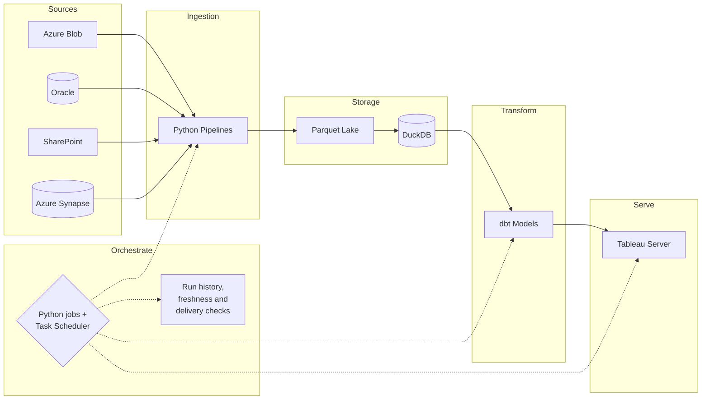

## Overview

The Modern Data Stack (MDS) is a data product that consolidates data from multiple source systems into a single queryable database, transforms it through version-controlled SQL, and enables self-serve analytics through Tableau — all orchestrated automatically.

> [!success] What This Achieves
> Automated daily pipelines across 4 markets, with no manual steps. About 500 dbt models (125 of them published reporting tables), version-controlled, documented and tested. When a job fails or a report does not land, I get an alert.

Every tool was chosen because it worked within our constraints:

| Constraint | Solution |
|------------|----------|
| No cloud approval | DuckDB runs locally |
| No budget | All tools are free/open source |
| Corporate network blocks packages | DuckDB-native SQL; dbt test packages installed through a small installer that works with the corporate proxy (2026) |
| Read-only Oracle | Parquet files as intermediate storage |
| Single machine | One writer at a time: jobs wait for the database lock, and reads go through a read-only query broker |
| Unreliable network share | Write locally first, copy to the share afterwards |

---

## Architecture



---

## Data Sources

Data flows in from four source systems. See [[sources]] for details on each.

- **Oracle** — legacy transactional database (sales, inventory, customers)
- **Azure Blob** — the QI Data Lake (CSVs from legacy systems)
- **Azure Synapse** — operational data warehouse
- **Network Drives** — business-managed spreadsheets (budgets, TSV plans)

The official data lake had issues that made it unusable for interactive analysis. See [[parquet-lake]] for how I built a local mirror.

---

## DuckDB — The Foundation

[[duckdb|DuckDB]] is the analytical database at the centre of everything. All data lives here after ingestion, and all transformations happen here.

**Why DuckDB:**
- Runs locally on a single machine — no server infrastructure
- Reads Parquet files directly — no separate loading step
- Fast analytical queries — columnar storage, vectorised execution
- Single file database — easy to backup, move, or restore

Since October 2026 it runs on DuckDB 2.0. The upgrade changed no model SQL; the work was in certificate handling behind the corporate proxy and a tested rollback path.

The database file is built locally on an SSD for speed. Originally the source Parquet files lived on network drives; since mid-2026 they live locally too, and the network share is only a mirror. See [[challenges#Challenge 7: Network vs Local Build Strategy|the build strategy challenge]] for how I optimised this.

---

## dbt — The Transformation Layer

[[dbt]] handles all SQL transformations. Every piece of business logic lives here as version-controlled SQL.

**Medallion architecture:**

```
dbt/models/
├── a_staging/           # Raw → Standardised (one folder per source system)
│   ├── oracle_uk/
│   │   └── refined/     # curated, typed, persisted copies
│   ├── oracle_de/
│   ├── data_lake_qi/
│   ├── synapse/
│   ├── sap_jp/
│   ├── sas_it/
│   └── business_created/
│
├── b_intermediate/      # Standardised → Business Logic
│   ├── orders/
│   ├── products/
│   ├── customers/
│   └── legacy/
│
└── c_marts/             # Business Logic → Final Datasets
    ├── commercial/
    ├── customers/
    ├── operations/
    ├── scorecards/
    └── tableau_reporting/
```

Staging folders are named after the system the data comes from, with the source as the prefix, so all Oracle folders sort together. (In 2025 they were grouped by how the data arrived: `azure/`, `oracle/`.) As of October 2026 there are about 500 models: roughly 160 staging, 210 intermediate and 125 marts.

**Materialisation strategy:**
- Staging: Views (computed on query, no storage)
- Refined staging: Tables (a curated column subset, cheap to query)
- Intermediate: Views by default, tables where the logic is heavy
- Marts: Tables (persisted, fast to query)

See [[dbt-duckdb]] for technical patterns and SQL reference.

---

## Orchestration — Plain Python Jobs

From 2025 until May 2026, [[dagster]] coordinated everything. On a single Windows desktop it cost more memory than it was worth, so I replaced it with something simpler. The Dagster page explains why.

**How it works now:**
- **One Python job per pipeline**, split into numbered phases. Each phase retries with a back-off, and a failed run resumes from the phase that broke.
- **Windows Task Scheduler, driven by one manifest file** in version control. A script registers every task from it, so the whole schedule can be rebuilt on a new machine with one command.
- **A run-history database.** Every dbt build records who ran it, what it selected, and per-model timing and status. A live view shows each in-flight model against its 30-day average, so "slow" and "stuck" are measured, not guessed.
- **Gates.** A freshness gate flags stale source feeds. A deliverables gate checks a register of every output that should exist and alerts when something that should have shipped did not.
- **Alerts and triage.** Failures go to my phone and to Teams. An AI step reads the failed phase's log, writes a post-mortem and files a triage note for me to review.

**Key jobs:**

| Job | What it does |
|-----|--------------|
| Morning refresh | Oracle and Synapse extracts, the core dbt build, Tableau extracts and a database backup |
| Azure ingest | Syncs the data lake feeds for all four markets, including orders |
| Weekly reports | Builds and publishes the weekly scorecard chain |
| Monthly refresh | Month-start models and reports, in the first days of the month |

**Concurrency control:** DuckDB only allows one writer at a time. Jobs are spaced through the day, a task cannot start a second copy of itself, and a job that finds the database locked waits for it to free up. Ad-hoc reads go through a read-only query broker that queues and waits through locks instead of hanging.

---

## Python Pipelines — The Ingestion Layer

Custom [[python-pipelines|Python pipelines]] handle getting data from source systems into Parquet files.

**Main patterns:**
1. **Azure Blob → Parquet**: Downloads CSVs, converts to Parquet with proper typing
2. **SharePoint → Parquet**: Fetches Excel files, normalises to Parquet
3. **State tracking**: Each pipeline remembers what it's processed, only fetching new files

**Why custom pipelines:** Corporate network blocks most packages. Sources have quirks (European CSV dialects, encoding issues). Simpler to maintain code we fully understand.

---

## Tableau — The Serving Layer

[[tableau]] is how data reaches the business. The scheduled jobs publish extracts to Tableau Server automatically (Dagster did this until May 2026).

**The pattern:**
- dbt builds mart tables
- Python script exports to Hyper format
- The job publishes to Tableau Server
- Business users see fresh data in their dashboards

---

## The Daily Flow

What happens automatically every day (October 2026):

**About 7:10 AM** — Morning refresh
- Oracle and Synapse extracts run in two parallel lanes
- The core orderline model is rebuilt with overnight data, usually by about 8:00
- Tableau extracts are built and published; the largest (tens of millions of rows) uploads in the background while later models build
- Database backed up and mirrored to the network share

**About 10:20 AM** — Azure data lake ingestion
- Orders for all 4 markets synced
- Reference data refreshed

**Midday** — Order freshness gate checks the feeds and alerts if one is stale

**3:00 PM** — Deliverables gate checks that every scheduled output actually landed

**6:00 PM (Mon–Sat)** — Weekly scorecard chain

In 2025 the flow was simpler: a 7:15 AM UK refresh, a 3:15 PM data lake ingest and a 3:45 PM daily sales pipeline, all run by Dagster.

---

## Design Principles

**Configuration over code** — Adding a new Tableau export is 5 lines of config, not 50 lines of Python.

**Explicit dependencies** — Every dbt model declares its inputs with `ref()`, and every job runs its phases in a planned order. No hidden dependencies, no mystery failures.

**Check outputs, not just jobs** — A job that ran is not the same as a report that landed. The deliverables gate checks the outputs.

**Fail-safe operations** — Pipelines backup before overwriting. If a write fails, the previous version is restored.

**Multi-market by default** — Every model considers that data comes from 4 markets. Customer IDs are always paired with market codes.

---

## Related

- [[case-studies]] — Real-world examples of this architecture in action
- [[challenges]] — Problems solved while building this system
